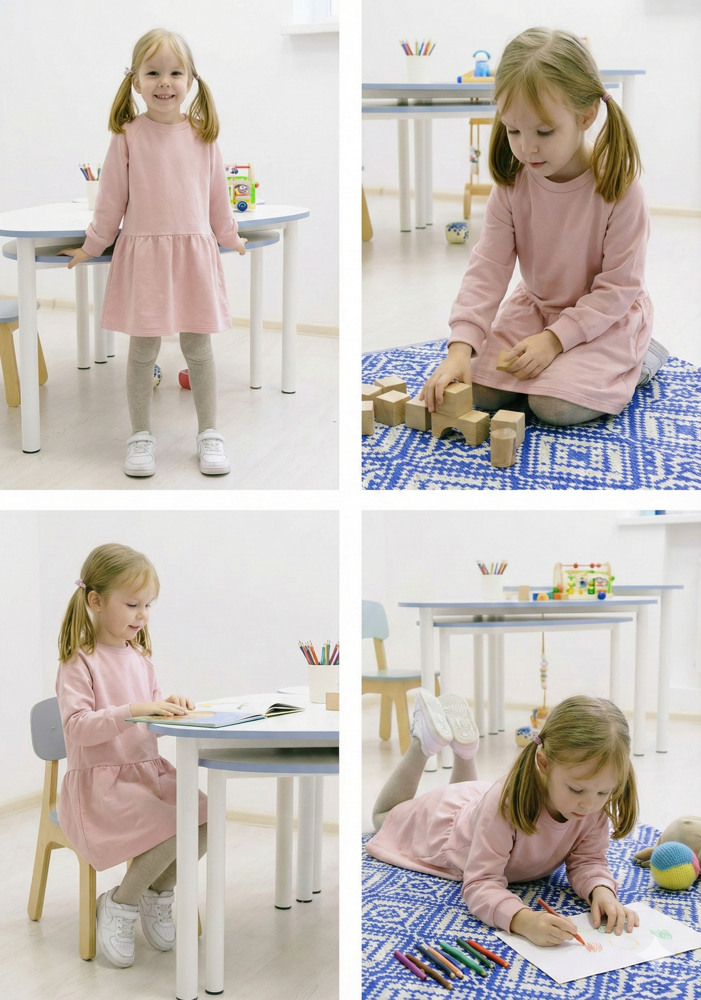

# Friendship Corner Daycare Website

A modern, responsive website for Friendship Corner Daycare built with **Next.js 16**, **React 19**, **TypeScript**, and **TailwindCSS v4**. This website replaces the existing site with enhanced visual aesthetics, animations, and improved user experience.

## Promotional assets

Poster, flyer, brochure, and promotional video originals live in [`posters/`](posters/README.md). These marketing files are maintained separately from the website.

## Website static assets

See [public directory guidelines](docs/assets/public-directory.md) for resource ownership and safe lossless optimization. Run `npm run optimize:public` to recompress PNGs without changing their pixels or URLs.

## 🖼️ Visual Showcase

<div align="center">
  
  
</div>

## 🌟 Features

### ✅ Implemented Features

- **🎨 Multi-Theme Support**: 5 beautiful themes (Professional, Nature, Playful, Dark, Violet)
- **✨ Advanced Animations**: GSAP ScrollTrigger & Framer Motion for premium feel
- **🖼️ Photo Hero Carousel**: Slides rendered through `next/image` with responsive srcset, AVIF/WebP, and `fetchpriority="high"` on the first slide (the hero is the LCP element)
- **🍱 Modern Layouts**: Bento Grid & Montessori Card designs for information display
- **🌍 Internationalization**: Full content switching for English, Spanish, French, Korean, and Chinese with localized metadata and fallbacks
- **🔍 SEO & GEO**: Per-page metadata with SERP-length-aware titles, canonical + hreflang, server-rendered structured data (ChildCare/LocalBusiness, EducationalOrganization, FAQPage, Course, BreadcrumbList), XML sitemap with image entries, robots.txt that welcomes AI crawlers, hard 404s for unknown program slugs, 308 redirects for retired URLs, and `llms.txt` / `llms-full.txt` for generative engines
- **📲 Installable PWA**: Serwist service worker (built by `next build`), precached pages for offline reading, maskable icon and install screenshots, iOS home-screen meta tags
- **📱 Responsive Design**: Optimized for all devices with Mobile QR Access
- **🖼️ Image Gallery**: Animated carousel with category filtering and lightbox view
- **🗺️ Google Maps Integration**: Interactive map showing daycare location
- **⚡ Performance**: Responsive hero images (382 KB raw JPEG → 30 KB WebP at 640 px), run-once GSAP ScrollTrigger animations, React 19 server components. Builds run on webpack — Serwist's service-worker integration is webpack-only today

### 🏗️ Project Structure

```text
src/
├── app/                    # Next.js App Router
│   ├── page.tsx           # Homepage (single-page sections + FAQ + contact)
│   ├── programs/[slug]/   # Toddler / Preschool / Pre-Kindergarten pages
│   ├── community/         # Montessori, ECE, journal, today's story
│   ├── funding/           # Subsidies & tuition
│   ├── service-area/      # Tri-Cities page (bilingual EN + 中文)
│   ├── our-team/          # Educators
│   ├── resources/         # Parent handbook & forms
│   ├── gallery-new/       # Photo & video gallery
│   ├── welcome/           # Tour request form (QR flyer landing)
│   ├── privacy|terms/     # Legal pages
│   ├── sitemap.xml/       # XML sitemap route
│   ├── robots.ts          # robots.txt (incl. AI crawlers)
│   ├── sw.ts              # Serwist service-worker source (builds to public/sw.js)
│   ├── api/               # contact, maps, welcome route handlers
│   └── globals.css        # Global styles & theme system
├── components/
│   ├── layout/            # Header, Footer, Navigation, breadcrumbs
│   ├── providers/         # Language + service-worker registration
│   ├── seo/               # JSON-LD structured-data components
│   ├── sections/          # Page sections
│   └── ui/                # Reusable UI components
├── contexts/              # React contexts (Theme, Language)
├── data/                  # Programs, FAQ, staff, reviews content
├── i18n/                  # Internationalization config
├── lib/                   # SEO, business profile, site map, R2/email integrations
└── messages/              # Translation files

proxy.ts                   # Middleware: legacy 308 redirects + hard 404 for unknown /programs/* slugs
```

## 🚀 Getting Started

### Prerequisites

- Node.js 20.9+ (Next.js 16 requirement)
- npm or yarn

### Environment variables

Copy `.env.example` to `.env.local` and fill in the values. Required for a fully working site:

| Variable | Used by |
| --- | --- |
| `NEXT_PUBLIC_R2_ACCOUNT_ID`, `R2_ACCESS_KEY_ID`, `R2_SECRET_ACCESS_KEY`, `R2_BUCKET_NAME` | Cloudflare R2 image storage (`src/lib/env.ts` validates these) |
| `RESEND_API_KEY`, `RESEND_FROM_EMAIL` | Tour form + contact form email delivery |
| `GOOGLE_API_KEY` | `/api/maps` (Google Places lookup for the map section) |

Optional: `NEXT_PUBLIC_R2_CDN_URL` / `NEXT_PUBLIC_R2_PUBLIC_URL` (CDN override), `NEXT_PUBLIC_CALENDLY_URL`, `NEXT_PUBLIC_WHATSAPP_NUMBER`, `NEXT_PUBLIC_GOOGLE_PLACE_ID`.

### Installation

1. **Clone the repository**

```bash
git clone <repository-url>
cd friendshipdaycare
```

1. **Install dependencies**

```bash
npm install
```

1. **Start development server**

```bash
npm run dev
```

1. **Open in browser**
    Navigate to [http://localhost:3000](http://localhost:3000)

## 📋 Content Migration

The website content has been migrated and enhanced from the original site:

### School Information

- **Name**: Friendship Corner Daycare (Montessori)
- **Type**: Licensed Group Daycare (Non-profit society)
- **Established**: January 2008
- **Location**: Near Coquitlam Station, Coquitlam, BC
- **Address**: 2950 Dewdney Trunk Road, Coquitlam, BC V3C 2J4, Canada
- **Phone**: 604.945.8504
- **Email**: <friendship.care@live.ca>
- **Age Range**: 30 months to 5 years
- **Service Area**: Tri-Cities (Coquitlam, Port Coquitlam, Port Moody)

### Enhanced Content Features

- **Hero**: brand lockup as the H1 (`Friendship Corner`) above the "Coquitlam's Trusted Montessori Daycare" headline, with address / age / phone / email chips and Call Now + View Programs CTAs
- **Detailed Programs**: Toddler, Preschool, Pre-Kindergarten
- **Educational Focus**: Montessori method + gentle Bible stories
- **Safety & Quality**: Licensed, qualified staff, individual attention

## 🎨 Theme System

Six themes are defined in `src/app/globals.css` (`src/contexts/ThemeContext.tsx` switches between them):

1. **Professional** - Clean, trustworthy design with professional blue tones
2. **Warm** (`default`) - Classic warm colors for a welcoming daycare environment
3. **Nature** - Earth tones and greens
4. **Playful** - Bright and vibrant colors
5. **Dark** - Elegant dark theme
6. **Violet** - Soft violet tones (the theme applied on first visit)

Themes are stored in localStorage and applied system-wide.

## 🌍 Multi-Language Support

Supported languages:

- 🇺🇸 English
- 🇪🇸 Spanish  
- 🇫🇷 French
- 🇰🇷 Korean
- 🇨🇳 Chinese

Translation files are located in `src/messages/`.

## 🗺️ Google Maps Setup

1. Get a key from [Google Cloud Console](https://console.cloud.google.com/) with the **Places API** enabled.
2. Put it in `.env.local` as `GOOGLE_API_KEY` (server-side only).
3. `src/app/api/maps/route.ts` resolves the place and returns coordinates, a map URL, and a directions URL; `src/components/ui/GoogleMap.tsx` consumes it and falls back to a Google Maps search link built from `businessProfile` if the key is missing or the lookup fails.

The map section never renders a dead link: "Get Directions" always has a usable `href`.

## 📸 Gallery Setup

The gallery supports both photos and videos. Images are stored in **Cloudflare R2** (not locally).

**To add content:**

1. **Photos**: Upload images to R2 `images/` folder via Cloudflare dashboard
2. **Update** image arrays in gallery components using `/images/` paths
3. **Videos**: Update video URLs in the VideoPlayer components
4. **Access**: Use `getImageUrl('/images/filename.jpg')` helper function

See `src/lib/image-utils.ts` for the URL helper and `docs/codex_seo-geo.md` for the image/performance conventions.

## 🛠️ Technology Stack

- **Framework**: Next.js 16 with App Router
- **Language**: TypeScript
- **Styling**: TailwindCSS v4
- **Animations**: GSAP (GreenSock) + Framer Motion
- **UI Components**: Aceternity UI, Magic UI, Lucide Icons
- **Video**: React Player
- **Carousel**: Embla Carousel
- **Forms**: React Hook Form with Zod validation
- **Internationalization**: next-intl

## 📱 Pages Overview

The site is one long homepage plus a small set of real sub-pages. Older multi-page URLs
permanently redirect (308) so nothing dead-ends — see `src/proxy.ts`.

| Route | What it is |
| --- | --- |
| `/` | Single-page homepage: hero, about, mission, programs, gallery, video showcase, enrollment, fees & hours, FAQ, contact + map |
| `/programs/toddler`, `/programs/preschool`, `/programs/prekindergarten` | Real age-specific program pages (facts, curriculum, daily schedule, FAQs, Course + FAQPage schema) |
| `/funding` | BC Affordable Child Care Benefit, $10-a-day program, tuition info |
| `/service-area` | Tri-Cities page (bilingual English + Traditional Chinese) |
| `/our-team` | Educators |
| `/resources` | Parent handbook, forms, checklists |
| `/gallery-new` | Photo + video gallery |
| `/welcome` | Tour request form (QR flyer landing page) |
| `/community/montessori`, `/community/ece`, `/community/journal`, `/community/todays-story` | Education and classroom content |
| `/privacy`, `/terms`, `/sitemap` | Legal pages and HTML sitemap |
| `/sitemap.xml`, `/robots.txt`, `/llms.txt`, `/llms-full.txt` | Crawler/AI endpoints |

Retired URLs and where they go: `/about` → `/#about`, `/programs` → `/#programs`,
`/contact` → `/#contact`, `/enrollment` → `/#enrollment`, `/faq` → `/#faq`,
`/testimonials` → `/#testimonials`, `/gallery` → `/gallery-new`, `/team` → `/our-team`,
`/pricing` → `/funding`, `/policies` → `/resources`, `/journal` → `/community/journal`,
`/todays-story` → `/community/todays-story`, `/blog` → `/community/journal`.
An unknown `/programs/<slug>` returns a real 404 (not a soft 404).

## 🔧 Build & Deployment

### Development

```bash
npm run dev        # Start dev server (webpack)
npm run dev:turbo  # Dev server on Turbopack (no service worker)
npm run build      # Production build — also emits public/sw.js via Serwist
npm run start      # Start production server
npm run lint       # Run ESLint
npm run test:e2e   # Playwright regression suite (starts a dev server)
PLAYWRIGHT_CHANNEL=chrome npm run test:production # Build + production SEO/GEO/UI checks
```

Notes:

- `build` is pinned to `next build --webpack` because Serwist's service-worker integration is webpack-only today. The Turbopack variant is available experimentally via `@serwist/turbopack`.
- `public/sw.js` and `public/swe-worker-*.js` are build output — they are gitignored and must never be edited by hand.
- The service worker is disabled in development and registers only in production.
- Playwright needs a browser binary: run `npx playwright install chromium` once per machine (the pinned revision is 1161 for Playwright 1.51.1).

### Reference docs

Current (kept in sync with the code):

- `docs/codex_pwa.md` — PWA implementation, install criteria, offline behaviour, verification results
- `docs/codex_seo-geo.md` — SEO/GEO decisions, verification rounds, maintenance checklist
- `docs/codex_ui.md` — UI/UX audit method, findings, fixes and deferred items
- `docs/todo.md` — session log and open items

Historical research and AI advice transcripts — useful context, but they describe the site
before it was simplified to one page, so do not treat their route lists or recommendations as
current: `docs/04-18.md`, `docs/03-11.md`, `docs/03-20.md`, `docs/chatgpt.md`, `docs/claude.md`,
`docs/grok.md`, `docs/manus.md`, `docs/chatbot.md`, `docs/frontend-animation-*.md`,
`docs/friendshipdarycare-analysis.md` (see the correction note at its top), `docs/gemini.pdf`.

### Production Deployment

The site is optimized for deployment on:

- Vercel (recommended for Next.js)
- Netlify
- Any Node.js hosting provider

## 📞 Support & Contact

For questions about this website implementation:

- Review the documentation files
- Check the component source code
- Refer to Next.js and TailwindCSS documentation

For daycare enrollment and information:

- **Phone**: 604.945.8504
- **Email**: <friendship.care@live.ca>
- **Address**: 2950 Dewdney Trunk Road, Coquitlam, BC V3C 2J4, Canada

### Developer Credit

Website design and development by **Best IT Consulting** (<www.bestitconsulting.ca>).

---

**Built with ❤️ for Friendship Corner Daycare - Where Young Minds Flourish**

## Current verification and cleanup

See [production verification](docs/assets/production-verification.md) for the current SEO/GEO and responsive UI checks. The promotion popup, promotional cards, poster-sync script, generated promotion directory, and npm sync hooks have been removed. Classroom images, contact/tour forms, registration downloads, and standalone marketing files remain.
